# better_buyer 详细设计文档

| 项目 | 内容 |
|---|---|
| 文档版本 | v1.1（新增品类扩展与多模型决策） |
| 日期 | 2026-10-25 |
| 对应需求 | [requirements.md](./requirements.md) |
| 运行环境 | 云端 WSL2 + Ubuntu 24.04 + uv；手机 Android 13+ / Google Chrome |
| 文档状态 | 待评审 |

---

## 1. 文档说明

### 1.1 目标读者

产品、后端、前端（PWA）、测试与运维人员。本文档描述系统边界、模块职责、数据结构、接口、关键交互流程与实施计划，作为编码与验收的依据。

### 1.2 设计范围

覆盖需求文档中的全部功能：定时采集、品类券筛选（首期机票）、用户意图澄清、本地记忆上下文、价格预测、盯盘提醒、确认购买、选券、半自动下单、购买记录与品类通知；同时给出云端命令行客户端与手机 PWA 的分工。并支持**品类可插拔**（机票、酒店、茅台及自定义品类）与**多模型协同决策**（多 provider、多 API Key、综合打分）。

### 1.3 术语

| 术语 | 含义 |
|---|---|
| OTA | 携程、飞猪、同程等在线旅游平台 |
| 券（Coupon） | 平台发放的满减、直减、折扣类优惠凭证 |
| 实付价 | 票面价（含税）减去可用券后的用户实际支付金额 |
| 深链（Deep Link） | 携带标的、日期、券参数的平台官方页面链接 |
| 盯盘 | 后台按周期采集并预测，命中买点时提醒用户 |
| 记忆文件 | `memory/user_memory.md` 等用户偏好与历史记录 |
| 半自动下单 | 系统给出最优方案与深链，用户自行在平台完成登录与支付 |
| 品类（Category） | 可独立配置的购买类型，如 `flight`、`hotel`、`moutai`，由 `CategoryStrategy` 定义差异 |
| 综合分（decision_score） | 本地模型与多个外部模型按权重聚合后的 0–1 决策可信度 |

---

## 2. 需求澄清与设计决策

### 2.1 已确认的关键决策

需求文档中有 6 处设计如果按字面实现，会带来不可实现或高风险的问题。经与需求方确认，采用如下方案。

| 编号 | 需求原文/原设计 | 问题 | 确认后的方案 |
|---|---|---|---|
| D1 | 定期获取携程、淘宝、京东、抖音商城的机票价格与优惠券 | 这些平台均无公开的机票价格/优惠券查询 API；京东、抖音商城的机票供给有限；直接抓取违反平台条款且有反爬、验证码风险 | 定义统一 `PlatformAdapter` 协议，预留官方开放平台与三方聚合数据服务接入点；用 `config/platforms.yaml` 的 `mode` 开关选择 `playwright`（缺省）或 `adapter`。Playwright 只做低频率公开页面采集，遇到验证码直接标记 `blocked` 并降级 |
| D2 | 用户确认后系统执行购买，登录信息保存在凭据 md 文件 | 服务端托管平台密码并自动支付存在账号与资金安全风险；主流平台支付需要短信/人脸等强验证；明文凭据落 md 不可接受 | 改为半自动深链下单：系统锁定最优平台与券并生成待支付深链，用户在手机 Chrome 内完成登录与支付；服务端不保存密码，只保存采集所需的加密会话；md 中仅记录脱敏账号别名 |
| D3 | 用 Markdown 文件作为数据存储 | 多智能体与后台盯盘并发写入会互相覆盖；无法做索引、事务、去重 | SQLite（WAL）作为唯一真源，按需/定时原子导出 `data/*.md` 供人阅读和检查；记忆文件仍保留 Markdown，便于用户直接编辑 |
| D4 | 手机端只放交互逻辑与登录授权信息 | 边界模糊，容易把通知、业务状态也做进手机端 | 手机端为 PWA：只保存设备令牌、Push 订阅、平台授权状态与 UI 草稿；偏好、历史、订单、盯盘任务全部在云端 |
| D5 | 系统只为机票设计 | 酒店、茅台的槽位、券规则、比价维度、下单方式和通知完全不同，硬编码会导致每加一个品类都改核心代码 | 抽象 `CategoryStrategy`：品类只提供槽位 schema、券过滤、排序规则、预测特征、深链与通知模板；主智能体只面向通用 `PurchaseIntent` 与 `Offer`。新增品类 = 一份配置 + 一个策略类 |
| D6 | 单模型或简单平均投票 | 单一模型偏差大、供应商故障即中断；多 Key 不隔离会互相挤占配额；不同模型可靠性不同，等权平均不合理 | `ModelRouter` 支持多 provider、多 API Key、角色（nlu/predictor/judge）与可选的品类排除清单；同一品类的全部可用 predictor 并行调用后，按方向一致性、价格合理性、置信度、历史准确率、证据完整度、成本综合打分；低分歧直接聚合，高分歧升级 judge |

### 2.2 需求中不合理或有风险的设计及修正

| 编号 | 原设计 | 风险 | 修正 |
|---|---|---|---|
| R1 | 多智能体自由协作，由 LLM 自主决定下一步 | 不可复现、可能误触发支付、难以审计 | 主智能体持有显式状态机；LLM 只做意图抽取、理由生成、预测投票；任何下单必须用户显式确认 |
| R2 | 全平台、全标的高频采集 | 请求量过大，极易被封禁 | 券每日 2 次全量；价格只采集活跃盯盘标的，默认 30 分钟一次；单平台并发 ≤ 2 并加抖动 |
| R3 | 每天 01:00 数据检查后不消费结果 | 检查等于没做 | 质检结果落库并分级告警；预测前再做轻量新鲜度校验 |
| R4 | 承诺“全网最低价” | 预测是概率问题，无法保证 | 输出“当前可获取渠道的最低实付价”与预测区间；文案明确不构成价格承诺 |
| R5 | 把所有平台券都抓下来再筛目标品类券 | 券量与噪声大，跨品类误用 | 按 `scope` 和标的/规格/门槛做硬过滤，券与订单强制绑定品类 |
| R6 | 后台盯盘与前台共用同一进程状态 | 崩溃后任务丢失、重复提醒 | 盯盘任务持久化，服务重启后恢复；提醒按 `task_id + window` 幂等 |
| R7 | 凭证直接写入 Markdown | 明文泄露 | 平台会话加密存 `vault`；Markdown 仅保留脱敏别名与授权状态 |
| R8 | 手机端承担全部交互与通知逻辑 | 离线、推送、授权状态无法统一 | PWA 只做展示与选择；状态由云端单一事实源提供 |

### 2.3 设计原则

1. **云端单一事实源**：业务状态、任务、记忆、凭据都在云端；客户端可随时丢弃。
2. **支付人工闭环**：系统不代扣、不保存支付凭据；只缩短决策与选券路径。
3. **确定性编排**：智能体之间通过结构化结果通信，状态迁移可审计、可回放。
4. **证据优先**：预测必须带数据新鲜度、样本量、置信度和理由；模型之间出现明显分歧时降级为观望。
5. **可离线验证**：`--mock` 模式不依赖网络、账号与密钥，能跑通全链路。
6. **默认安全**：最小权限、最小数据、默认加密、日志脱敏。
7. **品类可插拔**：机票只是首个品类；新增品类不修改编排层、API 与存储。
8. **多模型可配置**：模型、Key、角色、权重、阈值全部配置化；单 Key 或单模型故障可降级。

---

## 3. 系统架构

### 3.1 总体架构

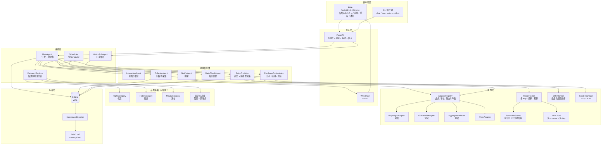

### 3.2 部署拓扑

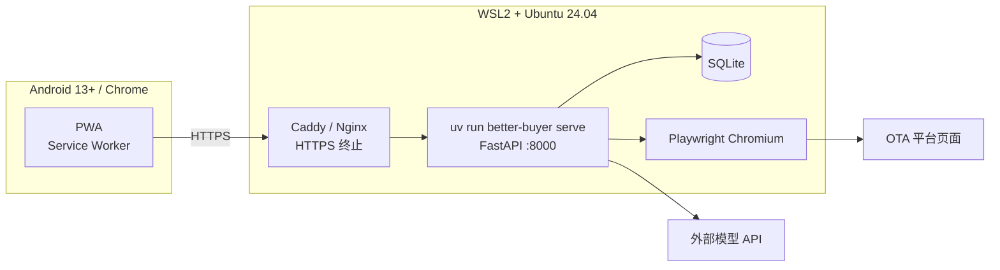

- 云端单进程运行 API、调度器与盯盘协程，避免跨进程锁；采集密集任务可拆独立 worker。
- PWA 的 Service Worker 与 Web Push 要求 HTTPS（`localhost` 例外），因此必须配置 TLS；本地演示可用 `cloudflared tunnel`。
- 手机与云端不在同一网络时，通过域名或隧道访问，不直接暴露 `0.0.0.0`。

### 3.3 技术选型

| 领域 | 选型 | 理由 |
|---|---|---|
| 运行时 | Python 3.11+ / uv | 与需求一致，依赖锁定简单 |
| Web | FastAPI + Uvicorn | 原生异步、SSE 友好、Pydantic 校验 |
| 调度 | APScheduler | 进程内 cron，足够单机规模 |
| 存储 | SQLite（WAL） | 零运维、事务与索引满足单用户场景 |
| 浏览器采集 | Playwright（Chromium） | 缺省采集方案，可隔离 profile |
| 前端 | 原生 HTML/CSS/JS + Service Worker | 轻量 PWA，无需构建链 |
| 推送 | Web Push（VAPID） | Android Chrome 原生支持 |
| 模型 | 任意 OpenAI 兼容接口 | 多供应商、可替换、可离线降级 |

---

## 4. 模块设计

### 4.1 主智能体 MainAgent

职责：

- 持有购买会话状态机（品类无关），是唯一允许修改业务状态的组件。
- 组装上下文：用户输入 + 记忆偏好 + 历史购买 + 最新价格/券 + 预测结论。
- 编排子智能体：交互 → 采集 → 预测 → 盯盘 → 购买 → 通知。
- 对 API 暴露 `handle_message`、`start_watch`、`prepare_purchase`、`issue_order`、`submit_receipt`。

约束：

- 子智能体只返回结构化结果，不能直接写业务表或改变状态。
- 每次状态迁移写入 `agent_events`，包含触发者、输入摘要、结果与耗时。
- 所有用户可见建议必须附带数据时间与免责声明。

### 4.2 交互智能体 InteractionAgent

输入：自然语言或结构化表单。抽取目标为 `category + slots`，槽位 schema 来自 `CategoryStrategy.slot_schema`（下列为 `flight` 示例，`hotel` 为城市/入住日/离店日，`moutai` 为 SKU/数量）。

输出：

```json
{
  "category": "flight",
  "slots": {
    "origin": "北京",
    "destination": "上海",
    "depart_date": "2026-11-08",
    "depart_time_pref": "上午",
    "cabin": "经济舱"
  },
  "budget": 2000,
  "missing": [],
  "confidence": 0.91
}
```

策略：

- 优先调用 `nlu` 角色模型做 JSON Schema 约束抽取；失败或未配置密钥时回退本地规则（城市词典、日期解析、预算正则）。
- 槽位必填/可选、追问文案与校验规则全部由品类 schema 提供；新增品类不改交互智能体。
- 每轮最多追问一个关键槽位；允许闲聊，但闲聊后回到缺失槽位。
- “改成后天”“预算 3000”等修改触发重新预测，不重建会话。
- 日期早于今天、城市无法识别、预算为负等直接给出纠正提示。

### 4.3 信息获取智能体 CollectorAgent

采集内容（由品类策略决定字段，统一写入带 `category` 的通用表）：

- 价格快照：平台、标的（航班号 / 房型 / SKU）、规格（舱位 / 床型 / 容量）、可比价与税费、采集时间。
- 优惠券：平台、券码、标题、类型、面额/折扣、门槛、适用标的与规格、有效期、来源。

调度：

| 任务 | 频率 | 范围 |
|---|---|---|
| 券全量采集 | 每日 08:00、20:00 | 已启用平台 × 已启用品类 |
| 价格增量 | 默认 30 分钟 | 仅活跃盯盘标的 |
| 冷启动 | 服务启动 / `collect` 命令 | 关注标的各一次 |

去重与可信度：

- 券按 `(category, platform, coupon_code)` upsert；价格按 `(category, platform, item_id, hour_bucket)` upsert，品类专属字段写入 `attributes_json`。
- `source ∈ {official_api, aggregator, playwright, mock}`；`confidence` 由来源与解析完整度决定。
- 降级快照标记 `stale=true`，预测与展示时必须提示“数据可能过期”。

### 4.4 平台适配层 PlatformAdapter

```python
class PlatformAdapter(Protocol):
    platform: str

    def fetch_prices(self, query: CategoryQuery) -> list[PriceSnapshot]: ...
    def fetch_coupons(self, category: str, query: CategoryQuery | None) -> list[Coupon]: ...
    def issue_deep_link(self, offer: Offer) -> str: ...
    def health(self) -> AdapterHealth: ...
```

`CategoryQuery` 由 `CategoryStrategy.build_query()` 生成（航线 / 城市+日期 / SKU），适配器只负责按平台取数，不理解品类语义。

实现：

| 实现 | 说明 |
|---|---|
| `PlaywrightAdapter` | 缺省。无头 Chromium，持久化 profile，按平台解析公开页面 |
| `OfficialAPIAdapter` | 预留官方开放平台/联盟 API 接入点 |
| `AggregatorAdapter` | 预留三方聚合数据服务接入点 |
| `MockAdapter` | 确定性假数据，用于离线调试与测试 |

策略路由：

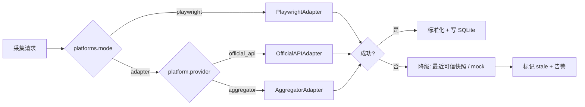

Playwright 约束：

- `headless=True`；单平台并发 2；请求间随机抖动 2–8 秒；页面超时 25 秒。
- 遇到验证码、登录墙或风控页：**不绕过**，记录 `blocked_reason`，本轮跳过并降级。
- 只采集公开可见内容；需要登录的部分采用“一次性扫码授权”，保存加密会话，不保存账号密码。
- 采集解析器必须有固定 HTML 快照测试，页面结构变化时测试失败并告警。

### 4.5 价格预测智能体 PricePredictor

本模块面向所有品类，不写品类分支：预测目标是品类的**可比价**（机票=含税总实付、酒店=每晚实付、茅台=到手单价与有货概率）。特征构造、季节曲线与提示词均由 `CategoryStrategy.build_prediction_features()` / `build_prediction_prompt()` 提供。

输入特征：

- 最近 N 次价格快照、价格波动率、距目标日天数、品类上下文（航线 / 城市+入住离店 / SKU）。
- 当前各平台实付价（含券）、券有效期、库存/余票信号（若可得）。
- 用户偏好与历史购买价格。

本地模型（品类无关骨架）：

```text
local_pred = w1 * EWMA(recent_prices)
           + w2 * seasonal_curve(context)
           + w3 * trend(recent_prices)
```

多模型协同：

- 通过 `ModelRouter` 并行调度该品类下全部可用 predictor（多 provider、多 API Key），调度与容错详见 §4.13。
- 只输入结构化统计，不输入原始 HTML；要求所有模型返回同构 JSON：

```json
{
  "predicted_price": 1280,
  "direction": "down",
  "confidence": 0.68,
  "reasons": ["近 3 天价格持续下行", "距出发 14 天处于历史低价区间"],
  "evidence": ["样本量 18", "波动率 6%"]
}
```

- 输出做硬性限幅：预测价限制在当前价的 ±30% 内；非法 JSON 丢弃。
- 聚合由 `EnsembleScorer` 完成：方向一致性、价格合理性、置信度、历史可靠性、证据完整度、成本综合打分，得到加权中位数与 `decision_score`；不再使用固定的本地/模型等权平均。
- 方向分歧超阈值或接近买入阈值时升级 `judge` 复核。
- 全部 predictor 失败时仅用本地模型，置信度上限 0.6。

输出：

```json
{
  "category": "flight",
  "current_effective_price": 1280,
  "predicted_median": 1395,
  "predicted_range": [1250, 1520],
  "recommendation": "buy_now",
  "decision_score": 0.74,
  "confidence": 0.72,
  "optimal_window": ["2026-11-02", "2026-11-05"],
  "reasons": ["当前实付低于预测中位数 8%", "目标券 48 小时后过期"],
  "model_votes": [{"model": "A", "direction": "down", "score": 0.78}],
  "data_freshness_minutes": 12,
  "disclaimer": "基于历史与模型估计，不构成价格承诺"
}
```

### 4.6 购买编排智能体 PurchaseOrchestrator

流程：

1. 用户确认购买后，实时刷新目标标的与券，不使用盯盘缓存。
2. `OfferRanker` 校验：券 `scope` 与当前品类一致 → 标的匹配（航线 / 城市+日期 / SKU）→ 规格/舱位匹配 → 门槛满足 → 未过期 → 可叠加规则。
3. 计算每个平台 `paid_price = price - discount`，按 `CategoryStrategy.rank_key()` 输出候选。
4. 用户选定方案后创建订单草稿（幂等键 `booking_id + platform + offer_hash`），生成深链。
5. 用户回执后更新订单状态；订单号无法校验时进入 `pending_review`，不自动重试支付。

排序规则（确定性，默认实现，可由品类覆盖）：

```text
paid_price ASC
→ 用户偏好平台优先
→ 券面额降序
→ 库存/可售状态（茅台等有货优先）
→ 数据可信度降序
→ 券过期时间升序
```

选券约束：

- 默认同平台只使用一张最优券；平台明确允许叠加时按规则处理。
- 跨品类券禁止使用；券必须属于当前订单品类与标的。
- 券过期或门槛不满足时从候选中剔除，并在界面说明原因。

### 4.7 数据检查智能体 DataCheckAgent

每日 01:00 运行，也可通过 `check` 命令手动触发。

| 级别 | 规则 | 处理 |
|---|---|---|
| Fatal | 必填字段缺失、价格 ≤ 0、满减券面额异常、日期格式非法、券有效期倒挂 | 标记 `quarantined`，禁止参与预测与比价，并推送告警 |
| Warn | 同一券码不同面额、同一标的同小时价格差异 > 40%、券已过期仍为 active、数据超过 24 小时未更新 | 标记并降权，写入报告 |
| Info | 重复采集、标的所在品类未启用、平台未启用 | 仅记录 |

产出：`check_reports` 表 + `data/check_report.md`（原子覆盖）+ 有 Fatal 时的推送摘要。

### 4.8 通知智能体 NotifyAgent

| 通知 | 触发 | 渠道 |
|---|---|---|
| 决策提醒 | 盯盘命中 `buy_now` | Web Push，失败降级 Webhook |
| 支付待办 | 深链生成 15 分钟未回执 | Web Push |
| 品类提醒 | 由 `CategoryStrategy.notification_plan()` 定义（机票出发前、酒店入住/取消截止、茅台补货/抢购/发货） | Web Push + `.ics`（含时间点者） |
| 质检告警 | 出现 Fatal | Web Push + Webhook |

- 提醒按 `(booking_id, type, window)` 幂等，避免重复推送。
- 推送失败记录 `notifications.status=failed`，可重试；`.ics` 作为兜底。
- 时间未知时使用品类默认值（如 `BB_DEPART_HOUR`），并在通知中提示用户校正。

### 4.9 后台盯盘 WatchSubAgent

- 每个 `booking` 同时最多一个活跃盯盘任务。
- 循环：增量采集 → 预测 → 判断是否命中 → 更新 `last_decision` → 睡到下一周期。
- 停止条件：窗口结束、品类时间窗临近（如起飞/入住前）、用户取消、订单已支付、连续失败超过阈值。
- 任务状态持久化；服务重启后扫描 `running` 任务恢复。
- 前台会话与盯盘通过事件队列通信，主线程始终可继续聊天。

### 4.10 手机端 PWA

页面：

1. 配对登录页：输入云端生成的 6 位配对码。
2. 品类选择页：从 `GET /categories` 渲染已启用品类；选择后按 `schema` 动态生成表单。
3. 对话页：消息流、建议卡片、槽位快捷修改。
4. 方案页：平台 + 券 + 实付价列表，含“为什么推荐”与模型投票（脱敏）。
5. 授权页：跳转平台前展示说明与深链按钮；回调后提交回执。
6. 通知设置：申请通知权限、订阅/取消 Push。

端侧只保存：

| 数据 | 存储位置 | 说明 |
|---|---|---|
| 访问令牌 | 内存 | 15 分钟过期，刷新后重新获取 |
| 刷新令牌 | HttpOnly Cookie | JS 不可读，设备可吊销 |
| Push 订阅 | IndexedDB | 端侧标识，不含业务数据 |
| 平台授权状态 | IndexedDB | 仅记录“已授权/未授权/过期”，不存 cookie |
| 未发送草稿 | localStorage | 断网时暂存输入，联网后重发 |

PWA 不保存价格、券、订单、偏好与历史；断网时展示缓存 UI 并提示“需要联网获取最新数据”。

### 4.11 命令行客户端 CLI

| 命令 | 作用 |
|---|---|
| `better-buyer chat` | 交互式对话（开场选择品类） |
| `better-buyer buy --category flight --origin ... --destination ... --date ...` | 一次性询价并可选下单（其他品类用对应槽位参数） |
| `better-buyer watch --booking-id ...` | 前台盯盘 |
| `better-buyer collect` | 立即采集 |
| `better-buyer check` | 立即质检 |
| `better-buyer serve` | 启动 API、调度器与盯盘 |
| `better-buyer export-md` | 手动导出 Markdown |
| `better-buyer orders` | 查看订单 |

CLI 与 PWA 调用同一套服务层，不复制业务逻辑。

### 4.12 品类扩展机制 CategoryStrategy

机票只是内置品类之一。系统统一用 `PurchaseIntent` 表达购买意图，品类差异全部下沉到策略类，主智能体、API、存储不感知具体品类。

```text
PurchaseIntent(
  category,                 # flight / hotel / moutai / 自定义 key
  slots: dict,              # 品类专属槽位
  budget?, preferences?, watch_window?
)
```

> 迁移说明：现有 `TravelRequest` 收敛为 `PurchaseIntent` 的 `flight` 特例（`origin/destination/depart_date` 进入 `slots`）；原有 `FlightPrice`、`Coupon` 语义分别并入 `PriceSnapshot` 与通用 `Coupon`。

策略协议：

```python
class CategoryStrategy(Protocol):
    key: str
    display_name: str
    slot_schema: dict[str, SlotSpec]          # 必填/可选/校验/追问文案
    def normalize_slots(raw: dict) -> dict    # 日期、城市、SKU 归一化
    def build_query(intent) -> CategoryQuery  # 采集参数：航线 / 城市+日期 / SKU
    def filter_coupon(coupon, intent) -> bool
    def rank_key(offer) -> tuple              # 品类比价维度
    def build_prediction_features(ctx) -> dict
    def build_prediction_prompt(features) -> str
    def build_deep_link(offer) -> str
    def notification_plan(order) -> list[NotificationSpec]
    def validate_quote(quote) -> list[Issue]  # 品类专属质检规则
```

内置品类差异：

| 品类 | key | 必填槽位 | 可选槽位 | 比价维度 | 券 scope | 紧急规则 | 通知 |
|---|---|---|---|---|---|---|---|
| 机票 | `flight` | 出发地、目的地、出发日期 | 出发时段、舱位、预算 | 含税总实付 | 机票 | 距起飞 ≤ 3 天且券将过期 | 出发前 24h / 3h |
| 酒店 | `hotel` | 城市、入住日、离店日 | 星级、房型、人数、预算 | 每晚实付 | 酒店 | 入住前 24h 且库存下降 | 入住提醒、取消截止 |
| 茅台 | `moutai` | SKU、数量 | 规格、心理价、渠道 | 到手单价 + 有货 | 白酒 | 低于心理价且有库存 | 补货/降价、抢购、发货 |
| 自定义 | 任意 key | 由配置声明 | 由配置声明 | 由策略实现 | 自定义 | 由策略实现 | 由策略实现 |

新增品类的完整清单（核心代码零改动）：

1. 在 `config/app.yaml` 追加品类（或放入 `config/categories/<key>.yaml`）：策略类路径、`coupon_scope`、槽位 schema、排序键、买入阈值、可选模型排除清单、通知计划。
2. 新增 `src/better_buyer/categories/<key>.py` 实现 `CategoryStrategy`。
3. 在 `config/platforms.yaml` 声明该品类可用的平台；无真实源时启用 Mock 生成器。
4. 补充测试：槽位校验、券过滤、排序、深链、通知计划。

隔离规则：

- 所有业务表带 `category` 列，仓储层查询强制按品类过滤。
- 券与订单强制绑定品类，禁止跨品类复用券。
- 品类可独立启停；停用后保留历史数据但不再采集与推荐。
- 不同品类可配置**可选的模型排除清单**与买入阈值；默认所有启用的 predictor 都参与该品类决策。

### 4.13 多模型决策 ModelRouter + EnsembleScorer

#### 4.13.1 角色

| 角色 | 用途 | 调用时机 | 典型模型 |
|---|---|---|---|
| `nlu` | 槽位抽取、意图改写、追问生成 | 每轮对话 | 低延迟小模型 |
| `predictor` | 价格/库存/方向预测，返回结构化 JSON | 每轮询价与盯盘 | 多个中小模型并行 |
| `judge` | 复核分歧、评估证据、给定性意见 | 分歧超阈值或接近买入阈值 | 高能力模型 |

同一供应商可配置多个实例（不同 API Key、额度、权重），用 `family`、`max_rpm`、`cost_tier` 区分。

#### 4.13.2 决策流水线

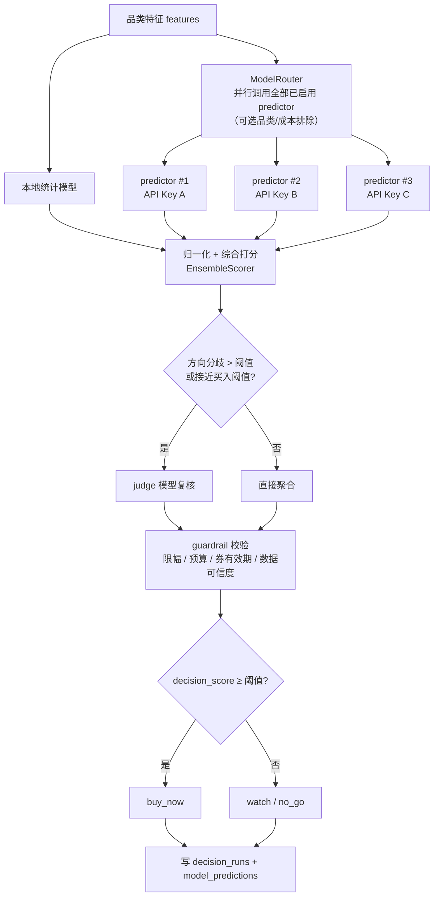

默认不做静态筛选：同一品类下，所有已启用且健康的 predictor 都并行调用，把各自的预测、方向、置信度与证据一起交给 `EnsembleScorer` 综合评定。品类排除清单只用于成本控制或已知能力不足的模型，不是调用门槛；模型间的质量差异由历史可靠性动态加权处理，而不是在调用前一刀切。

#### 4.13.3 综合打分

```text
model_score_i =
    w_dir  * direction_agreement_i          # 0..1
  + w_dev  * price_plausibility_i           # 1 - min(1, |pred_i - median| / median)
  + w_conf * confidence_i                   # 模型自报置信度
  + w_rel  * reliability_i                  # 该模型在该品类的历史准确率
  + w_evid * evidence_completeness_i        # 是否引用输入统计、给出可核验证据
  - w_cost * cost_penalty_i                 # 价格/延迟成本惩罚

consensus_direction = argmax(按 model_score 加权的方向票数)
predicted_final     = weighted_median(predictions, weights = model_score)
decision_score      = w_local * local_quality
                    + w_models * normalize(sum(model_score))
                    + w_judge * judge_score
verdict             = buy_now 当且仅当 decision_score ≥ 阈值 且 guardrail 全部通过
```

- 权重与阈值全部在 `config/llm.yaml` 配置，归一化后求和为 1。
- `reliability_i` 初始 0.5，由回测自动校准，是**主要的质量控制机制**；静态品类排除只用于成本或能力边界，不承担质量筛选。
- `guardrail` 优先级最高：限幅 ±30%、预算上限、券有效期、数据 stale/quarantined、用户预算，任一不通过都不能给出 `buy_now`。

#### 4.13.4 多 API Key 调度

- 每个 provider 条目对应一个 `api_key_env`，密钥只从环境变量读取，不写入配置、不落库、不打日志。
- 同一 `family` 下多个 Key 按 `weight` 轮询；单 Key 令牌桶限流（`max_rpm`）。
- 默认调度对象是该品类下**全部**启用且健康的 predictor；`categories` / `models.exclude` 只做可选排除，不设置即全量参与。
- Key 级熔断：连续 3 次失败或 401/429 → 冷却 60 秒并降权，健康 Key 接管。
- 预算控制：`max_calls_per_decision`、`daily_token_limit`；超限时按 `cost_tier` 从高到低裁剪（先停用高成本模型），至少保留本地模型与 1 个 predictor。
- 结果缓存：同一 `(category, query_hash, hour)` 10 分钟内复用。

#### 4.13.5 可靠性校准

- 每次决策将各模型原始输出写入 `model_predictions`。
- 3 天后用实际价格（或成交价）回测：计算 MAE、方向准确率、Brier 分数。
- 按指数平滑更新 `model_stats.reliability_score`（默认 α=0.2），按品类独立统计。
- 新模型冷启动 20 次内使用默认可靠性 0.5，并标记 `cold_start`。

#### 4.13.6 失败与降级

| 场景 | 处理 |
|---|---|
| 部分模型超时/报错 | 剩余模型继续打分，记录缺失模型，置信度惩罚 |
| 全部 predictor 失败 | 本地模型单独决策，`confidence ≤ 0.6`，提示“模型不可用” |
| judge 失败 | 使用未复核的聚合结果，`decision_score` 扣减 0.1 |
| 预算超限 | 降级为“本地 + 1 个低成本 predictor” |
| 模型输出非 JSON | 重试 1 次；仍失败则丢弃该票并计为失败 |

#### 4.13.7 可解释性

- `decision_runs` 保存输入特征摘要、各模型预测与分数、聚合结果、judge 意见与最终 verdict。
- PWA「为什么推荐」展示模型投票表（模型名脱敏为 Model A/B/C）、关键理由与数据新鲜度。
- 用户可见文案不得暴露 API Key、内部提示词与原始 HTML。

---

## 5. 数据设计

### 5.1 存储架构

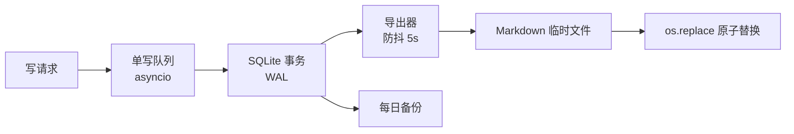

- SQLite 为唯一真源，开启 WAL。
- 所有写操作经单写队列串行化，事务短小；读操作可并发。
- Markdown 是导出视图，写入 `tmp` 后原子替换，导出失败不影响主流程。
- 每日备份 `data/backup/*.db`，保留 7 天。

### 5.2 实体关系

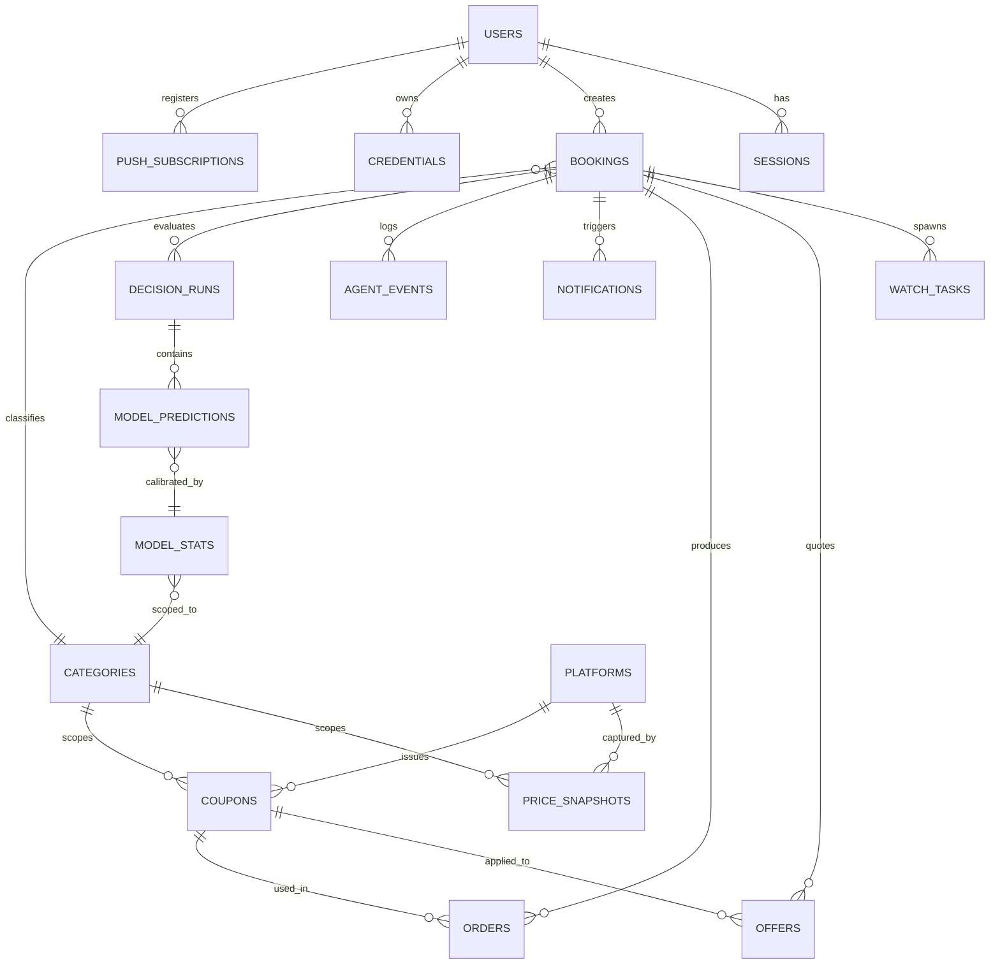

> `categories` 是配置驱动的逻辑表（启动时由 `config/app.yaml` 与 `config/categories/*.yaml` 同步），用于校验 `category` 外键与统计隔离。

### 5.3 核心表

| 表 | 关键字段 | 约束/索引 |
|---|---|---|
| `users` | id, device_id, display_name, created_at | `device_id` 唯一 |
| `sessions` | id, user_id, status, created_at, updated_at | `user_id + created_at` |
| `categories` | key, display_name, strategy, enabled, config_json, updated_at | `key` 主键；启动时与配置同步 |
| `bookings` | id, user_id, **category**, title, slots_json, attributes_json, budget, status, window_start, window_end, created_at | `user_id + created_at`、`category + status` 索引 |
| `watch_tasks` | id, booking_id, category, interval_minutes, window_end, next_run_at, status, last_decision | `next_run_at`、`status` 索引 |
| `price_snapshots` | id, **category**, platform, item_id, attributes_json, price, tax, source, confidence, captured_at, hour_bucket | `(category, platform, item_id, hour_bucket)` 唯一 |
| `coupons` | id, **category**, platform, coupon_code, title, coupon_type, amount, min_spend, valid_from, valid_to, scope_json, source, confidence, status, collected_at | `(category, platform, coupon_code)` 唯一；`status`、`valid_to` 索引 |
| `offers` | id, booking_id, category, platform, item_id, price, coupon_id, discount, paid_price, attributes_json, quoted_at | `booking_id + quoted_at` |
| `orders` | id, booking_id, category, platform, list_price, coupon_id, discount, paid_price, order_no, status, deep_link, idempotency_key, paid_at | `idempotency_key` 唯一 |
| `credentials` | id, user_id, platform, account_alias, auth_type, ciphertext, nonce, key_version, expires_at | `user_id + platform` 唯一 |
| `push_subscriptions` | id, user_id, endpoint, p256dh, auth, ua, revoked_at | `endpoint` 唯一 |
| `notifications` | id, user_id, booking_id, category, type, channel, payload, status, scheduled_at, sent_at | `scheduled_at`、`status` 索引 |
| `check_reports` | id, run_at, category, fatal_count, warn_count, summary, details_json | `run_at`、`category` 索引 |
| `agent_events` | id, booking_id, category, agent, event_type, payload, created_at | `booking_id + created_at` 索引 |
| `decision_runs` | id, booking_id, category, input_features_json, local_pred, aggregated_pred, decision_score, verdict, judge_used, created_at | `booking_id + created_at`、`category` 索引 |
| `model_predictions` | id, decision_run_id, category, provider, model, role, prediction, direction, confidence, score, is_cold_start, cost_usd, created_at | `decision_run_id`、`(category, model, created_at)` 索引 |
| `model_stats` | id, category, provider, model, samples, mae, direction_accuracy, brier, reliability_score, updated_at | `(category, provider, model)` 唯一 |

> 所有业务表必须带 `category`；仓储层对外接口强制以 `category` 为必需参数，禁止跨品类查询。`attributes_json` 存放品类专属字段，避免为每个品类加列。

### 5.4 Markdown 导出与记忆文件

| 文件 | 内容 | 写入方式 |
|---|---|---|
| `data/coupons.md` | 有效券与 30 天内过期券，按品类分组 | 定时覆盖 |
| `data/prices.md` | 近 7 天价格快照，按品类分组 | 定时覆盖 |
| `data/offers.md` | 最近一次比价结果 | 事件触发覆盖 |
| `data/orders.md` | 订单记录（脱敏） | 事件触发覆盖 |
| `data/decisions.md` | 最近 7 天决策摘要（模型脱敏、分数、方向） | 每日覆盖（可选开启） |
| `data/watchlist.md` | 关注标的 `品类 > 标的关键字 > 日期` | 双向：启动导入，变更导出 |
| `data/check_report.md` | 质检报告 | 每日覆盖 |
| `memory/user_memory.md` | 偏好与购买记录 | 购买后追加，偏好解析入库 |
| `memory/platform_accounts.md` | 平台账号脱敏信息 | 授权后更新 |

- 兼容旧文件名：`data/flight_prices.md` 仅作为 `flight` 品类的导出别名保留一个版本周期。
- 导出内容与数据库一致带 `category` 列；不同品类数据不混排。
- 保留期：价格快照 180 天、券 90 天、决策与模型预测 365 天（用于回测校准）、审计 90 天；过期数据由每日备份任务清理。

凭据脱敏示例：

```text
- platform: 携程
  account_alias: ctrip_user_***@example.com
  auth_type: qr_session
  status: authorized
  expires_at: 2026-11-24
```

> 任何密码、cookie、token 原文都不得出现在 Markdown 中。

### 5.5 凭据管理

- 平台会话使用 AES-256-GCM 加密，密钥来自 `BB_MASTER_KEY` 或系统 keyring。
- 记录 `key_version`，支持主密钥轮换；解密失败视为授权失效，要求重新扫码。
- 日志只打印平台名、脱敏别名与状态，不打印密文或明文。
- 用户注销时删除对应凭据并吊销设备。

### 5.6 并发与一致性

| 场景 | 方案 |
|---|---|
| 并发采集写同一行 | 唯一键 upsert + 单写队列 |
| 盯盘重复触发 | `status` 与 `next_run_at` 乐观锁 |
| 重复下单 | `Idempotency-Key` + 订单草稿唯一键 |
| 导出与写入冲突 | 导出只读事务 + 临时文件 + 原子替换 |
| 进程崩溃 | WAL 恢复；启动扫描未完成任务并续跑 |
| 多设备登录 | 允许，但同一 booking 的处理以最后操作为准并记录审计 |

---

## 6. API 设计

### 6.1 约定

- Base：`/api/v1`；除 `/auth/*`、`/healthz` 外均需 Bearer Token。
- 错误结构：

```json
{
  "code": "COUPON_EXPIRED",
  "message": "所选优惠券已过期，请刷新方案",
  "trace_id": "01J..."
}
```

- 时间统一 ISO 8601，服务端按 `Asia/Shanghai` 解释，存储带时区。
- 分页：`?limit=50&cursor=...`。
- 幂等：`POST /orders`、`POST /orders/{id}/receipt` 必须带 `Idempotency-Key`。

### 6.2 接口清单

| 方法 | 路径 | 说明 |
|---|---|---|
| POST | `/auth/pair` | 配对码换取令牌 |
| POST | `/auth/refresh` | 刷新访问令牌 |
| POST | `/auth/logout` | 吊销当前设备 |
| POST | `/chat` | 发送消息并返回 SSE 流 |
| GET | `/chat/history` | 会话历史 |
| GET | `/categories` | 已启用品类列表（key、名称、槽位摘要） |
| GET | `/categories/{key}/schema` | 品类槽位 schema（PWA 动态渲染表单） |
| POST | `/bookings` | 创建购买任务，body 必填 `category` |
| GET | `/bookings/{id}` | 任务详情 |
| PATCH | `/bookings/{id}` | 修改槽位 |
| POST | `/bookings/{id}/watch` | 启动盯盘 |
| DELETE | `/bookings/{id}/watch` | 停止盯盘 |
| GET | `/bookings/{id}/offers` | 比价与选券结果 |
| POST | `/bookings/{id}/offers/refresh` | 强制刷新 |
| GET | `/bookings/{id}/decisions` | 决策历史与模型投票（脱敏） |
| POST | `/orders` | 创建订单草稿并返回深链 |
| POST | `/orders/{id}/receipt` | 提交支付回执 |
| GET | `/orders/{id}` | 订单状态 |
| POST | `/platform-auth/{platform}/qr` | 启动扫码授权 |
| GET | `/platform-auth/{platform}/status` | 授权状态（脱敏） |
| POST | `/push/subscribe` | 注册 Web Push |
| DELETE | `/push/subscribe` | 注销 Web Push |
| GET | `/coupons?category=flight&scope=` | 券列表（`category` 必填） |
| GET | `/prices?category=flight&item_id=&date=` | 价格快照（`category` 必填） |
| GET | `/models/health` | 各 provider/Key/角色的健康、熔断与预算状态 |
| GET | `/checks/latest?category=` | 最近质检报告 |
| GET | `/healthz` | 健康检查 |

### 6.3 SSE 事件

```text
event: token | slot_update | suggestion | decision | offers | order_update | notice | error
```

示例：

```json
{
  "event": "suggestion",
  "data": {
    "booking_id": "bk_123",
    "category": "flight",
    "recommendation": "watch",
    "decision_score": 0.62,
    "confidence": 0.62,
    "effective_now": 1280,
    "predicted_median": 1395,
    "optimal_window": ["2026-11-02", "2026-11-05"],
    "reasons": ["当前实付低于预测 8%", "目标券 48 小时后过期"],
    "model_votes": [
      {"model": "A", "direction": "down", "confidence": 0.68, "score": 0.78},
      {"model": "B", "direction": "flat", "confidence": 0.55, "score": 0.61}
    ],
    "judge_used": false,
    "data_freshness_minutes": 12
  }
}
```

事件通用字段：`booking_id`、`category`、`decision_score`；`order_update` 额外返回 `category` 与 `item_id`，便于 PWA 按品类渲染。

### 6.4 鉴权

1. 云端生成 6 位配对码，2 分钟有效，最多尝试 5 次。
2. 手机提交配对码，换取访问令牌（15 分钟）与刷新令牌（HttpOnly Cookie，30 天）。
3. 访问令牌过期后用刷新令牌续期；设备可在设置页吊销。
4. 所有资源按 `user_id` 过滤；越权返回 404，不泄露资源存在性。

---

## 7. 核心交互流程

### 7.1 主流程：澄清 → 预测 → 盯盘 → 购买

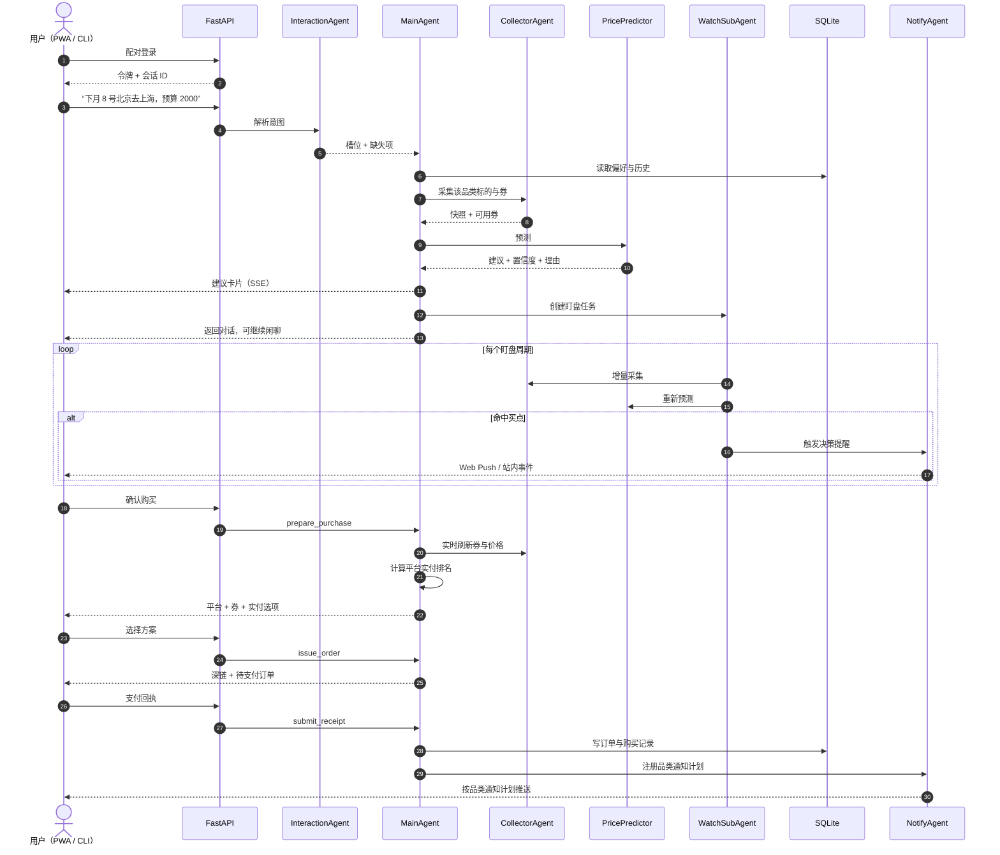

### 7.2 购买会话状态机（品类无关）

状态机由 MainAgent 统一持有，品类只能通过策略影响“是否命中建议”，不能新增状态或改变迁移。

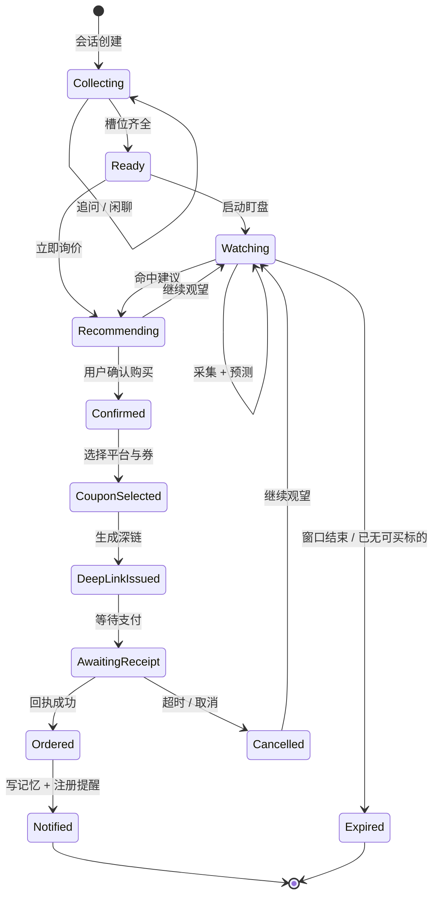

- `Expired` 的“已无可买标的”包括：机票航班售罄、酒店房型下架、茅台持续无货且超出盯盘窗口。
- 各品类的成功/失败判定由 `CategoryStrategy.validate_quote()` 与 `notification_plan()` 提供，状态迁移本身保持一致。

非法迁移直接拒绝并写审计事件；例如 `Collecting → Confirmed`、`AwaitingReceipt → Ordered` 之外的支付状态变更。

### 7.3 选券与深链下单

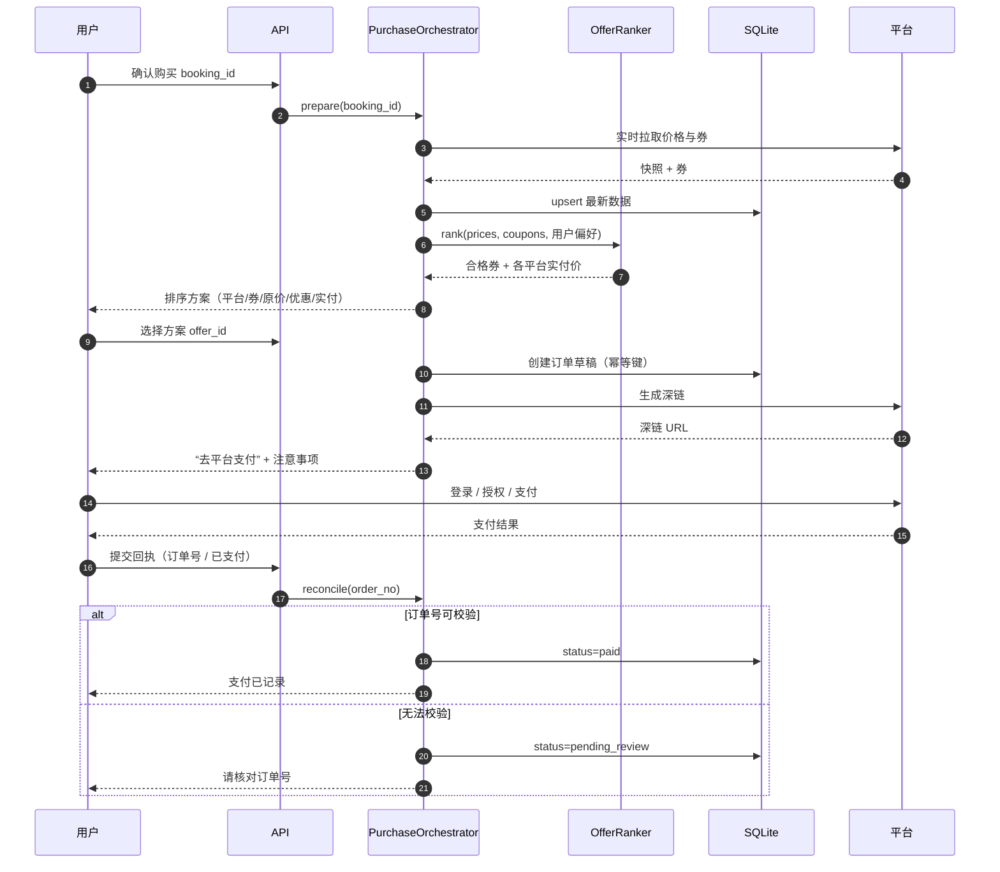

### 7.4 后台盯盘与提醒

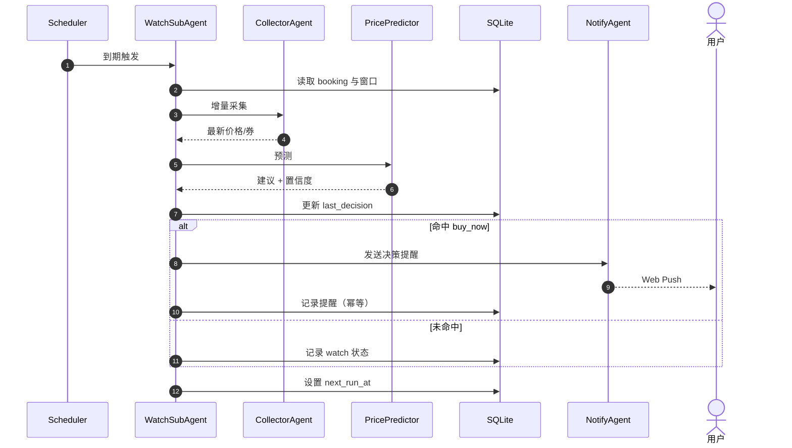

### 7.5 每日数据检查

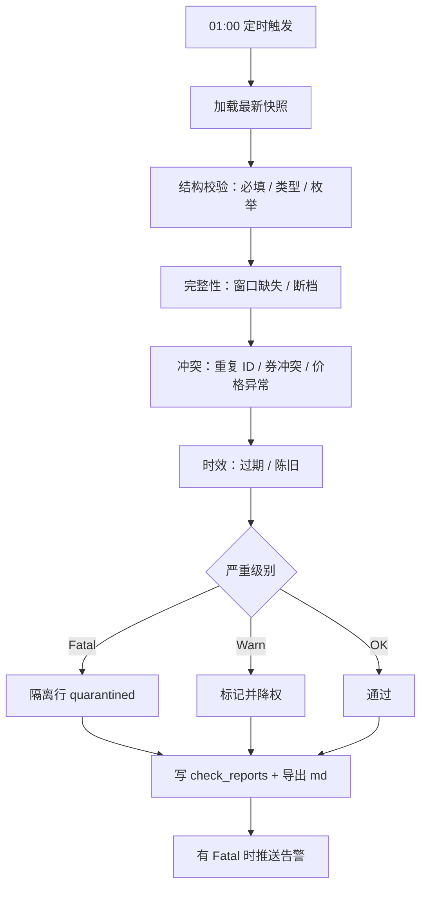

### 7.6 手机授权与推送

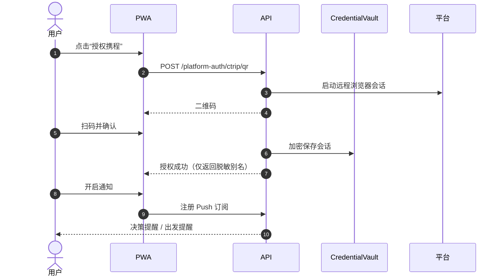

---

## 8. 预测与决策策略

### 8.1 决策规则

决策规则与品类无关，归一化后的可比价、阈值与紧急规则由 `CategoryStrategy` 提供。

```text
effective_now  = min_over_platforms(comparable_price - applicable_coupon)   # 品类可比价
predicted_median = EnsembleScorer(local_pred, model_preds)                 # 见 §4.13.3
margin = (predicted_median - effective_now) / predicted_median

guardrail = 数据新鲜 / 未隔离 / 券有效 / 预算不超 / 限幅通过

if not guardrail:
    recommendation = no_go
elif effective_now > user.budget:
    recommendation = no_buy，给出超预算的替代日期 / 平台
elif decision_score >= category.buy_score_threshold and margin >= min_saving_margin:
    recommendation = buy_now
elif category.is_urgent(context, coupons) or price_trend_up:
    recommendation = buy_now（附“风险提示”）
else:
    recommendation = watch
```

默认参数（可配置，按品类可覆盖）：

| 参数 | 默认值 | 说明 |
|---|---|---|
| `min_saving_margin` | 3% | 低于预测中位数的幅度 |
| `confidence_threshold` | 0.55 | 单模型聚合置信度下限 |
| `decision_score_threshold` | 0.60 | 综合分买入阈值（机票 0.60 / 酒店 0.62 / 茅台 0.68 示例） |
| `urgency_days` | 3 | 机票距起飞；酒店为入住前；茅台为补货窗口 |
| `history_window_days` | 30 | 本地特征窗口 |
| `local_weight / models_weight / judge_weight` | 0.5 / 0.4 / 0.1 | 由 `config/llm.yaml` 的 `scoring.final` 配置 |
| `model_score` 子权重 | 见 §4.13.3 | `direction / plausibility / confidence / reliability / evidence / cost` |

品类紧急规则示例：

| 品类 | 紧急条件 |
|---|---|
| 机票 | 距起飞 ≤ `urgency_days` 且余票下降或目标券 48 小时内过期 |
| 酒店 | 入住前 ≤ 24h 且目标房型库存下降 / 可取消截止临近 |
| 茅台 | 到手价 ≤ 心理价且库存由无变有（补货），或限购截止临近 |

### 8.2 防误导与可解释

- 展示预测区间，不只展示单点价格。
- 展示数据新鲜度与样本量；样本不足时标“低置信度”。
- 理由至少两条，且必须来自输入特征。
- 明确“不构成价格承诺”，不出现“保证最低”。
- 用户可查看“为什么推荐”，包括各模型方向与置信度。

### 8.3 校准

- 每周对比“建议买入后 3 天的实际价格”，计算命中率与平均偏差（同一逻辑用于 §4.13.5 的模型回测）。
- 按品类与模型分别统计 MAE、方向准确率、Brier 分数，指数平滑更新 `model_stats.reliability_score`。
- 偏差持续超标时降低对应模型权重或调整阈值。
- 校准结果写入报告，不自动修改用户配置；权重变更需显式提交配置。

---

## 9. 采集、适配与合规

### 9.1 策略开关

`config/platforms.yaml`：

```yaml
mode: playwright          # playwright | adapter | mock

platforms:
  - key: ctrip
    name: 携程
    enabled: true
    provider: playwright
    categories: [flight, hotel]
  - key: fliggy
    name: 飞猪
    enabled: true
    provider: playwright
    categories: [flight, hotel]
```

- `mode=playwright`：全部平台走 Playwright；可按平台覆盖 `provider`，也可用 `category_adapters` 按 `(品类, 平台)` 覆盖。
- `mode=adapter`：按平台 `provider` 选择官方 API 或聚合服务；未配置的适配器直接跳过。
- `mode=mock`：本地确定性数据，离线演示与测试使用。

### 9.2 采集频率与限流

- 券：每日 08:00、20:00 全量；单平台串行。
- 价格：活跃盯盘标的每 30 分钟；同平台并发上限 2；请求抖动 2–8 秒。
- 连续 3 次失败：指数退避并降低该平台权重；超过阈值标记 `blocked`，等待人工处理。
- 页面结构变化：解析结果为空或字段缺失率超阈值时，标记 `parser_broken`。

### 9.3 合规约束

- 遵守平台 robots 与用户协议；仅采集公开可见信息。
- 不绕过验证码、不伪造身份、不高频压测。
- 仅操作本人账号；不提供代下单、代支付。
- 生产启用前由使用者确认平台条款；文档与界面明确“自用工具”。

---

## 10. 安全设计

### 10.1 身份与设备

- 配对码一次性、短时效、限次数。
- 访问令牌短时效；刷新令牌 HttpOnly + Secure + SameSite=Lax。
- 设备可单独吊销；异常登录告警。

### 10.2 凭据

- 不保存密码、支付密码、短信验证码。
- 仅保存采集会话（加密）；用户支付会话留在用户设备。
- 密钥不写入仓库、配置或日志；通过环境变量或系统 keyring 注入。
- 支持轮换与失效处理；解密失败要求重新授权。
- 多个 LLM API Key 按 provider 条目独立管理：只从环境变量读取、按 Key 熔断与限额、互不共享配额；日志与错误响应只出现 `provider / model / key_alias`，不出现 Key 明文或前缀。

### 10.3 模型与提示词

- 外部模型只接收脱敏的结构化统计，不接收原始 HTML、cookie、账号与支付信息。
- 模型输出一律视为不可信输入：做 Schema 校验、数值限幅，且不得直接触发工具、下单或修改配置。
- 多模型投票与 judge 仅影响建议分，不改变 guardrail；guardrail 失败时任何模型意见都不能给出 `buy_now`。
- 每日限额与单次决策调用上限防止 Key 被滥用导致费用失控。

### 10.4 支付

- 系统不发起支付、不代扣、不保存支付方式。
- 深链只携带查询参数，不携带任何凭据。
- 回执与订单号仅用于记录，不作为支付凭证。

### 10.5 数据与提示注入

- 抓取页面文本一律视为不可信输入，不进入系统提示词。
- LLM 输出只作为建议字段，不直接触发工具或下单。
- 日志脱敏：token、cookie、手机号、邮箱、地址。
- 数据最小化：只采集比价必要字段；到期清理。

### 10.6 审计

- 记录登录、授权、改价、下单、回执、导出、删除等关键动作。
- 审计日志只追加，保留 90 天；敏感字段脱敏。

---

## 11. 可靠性与运维

### 11.1 故障处理

| 场景 | 处理 |
|---|---|
| 平台采集失败 | 重试 3 次 → 降级最近快照 → 标记 stale → 提醒用户 |
| 验证码/登录墙 | 不绕过，标记 blocked，暂停该平台并告警 |
| LLM 超时 | 单模型 20 秒超时；部分成功继续；全部 predictor 失败用本地模型，置信度 ≤ 0.6 |
| 单 Key 失效 / 限流 | 401/429 熔断 60 秒并降权，同 provider 的其他 Key 接管；无可用 Key 时降级 |
| 品类配置非法 | 启动时校验失败则拒绝加载该品类并告警，其他品类不受影响 |
| 推送失败 | 记录失败，降级 Webhook；保留 `.ics` |
| 订单号不匹配 | 进入 `pending_review`，人工核对，不自动重试 |
| SQLite 写入失败 | 重试一次；仍失败则暂停任务并告警，避免脏写 |
| 时区错误 | 全链路 `Asia/Shanghai`，航班时刻带时区，测试覆盖跨日航班 |

### 11.2 定时任务

| 任务 | 时间 |
|---|---|
| 券采集 | 08:00、20:00 |
| 价格采集 | 每 30 分钟（仅活跃盯盘标的） |
| 数据检查 | 01:00 |
| 备份 | 02:00 |
| 通知重试 | 每 5 分钟扫描失败记录 |

### 11.3 可观测性

- 结构化日志：`trace_id / user_id / booking_id / category / agent / platform / model / key_alias / duration_ms`。
- 指标：
  - 采集成功率、blocked 平台数、数据新鲜度。
  - 预测耗时、各模型失败率、Key 熔断次数、预算消耗、命中率。
  - 按 `category` 维度拆分：决策次数、buy_now 占比、回测 MAE 与方向准确率。
- 告警：全部 predictor 不可用、全部 Key 熔断、品类配置校验失败、judge 持续失败、决策分数异常分布。
- 健康检查：`/healthz` 返回数据库、调度器、模型池（按 provider/Key/角色）与推送状态；`/models/health` 提供明细。

---

## 12. 配置设计

### 12.1 `config/app.yaml`

```yaml
default_category: flight
timezone: Asia/Shanghai
categories_dir: config/categories        # 可选：每品类一份 yaml，与下列配置合并

categories:
  - key: flight
    name: 机票
    strategy: better_buyer.categories.flight:FlightCategory
    enabled: true
    coupon_scope: 机票
    slots:
      required: [origin, destination, depart_date]
      optional: [depart_time_pref, cabin, budget]
    ranking:
      primary: paid_price
      asc: true
    buy_score_threshold: 0.60
    prediction:
      urgency_days: 3
      min_saving_margin: 0.03
    models: {}                  # 可选：{exclude: [...]}；缺省全部 predictor 参与

  - key: hotel
    name: 酒店
    strategy: better_buyer.categories.hotel:HotelCategory
    enabled: true
    coupon_scope: 酒店
    slots:
      required: [city, checkin_date, checkout_date]
      optional: [star_level, room_type, guests, budget]
    ranking:
      primary: nightly_paid_price
      asc: true
    buy_score_threshold: 0.62
    prediction:
      urgency_days: 1
      min_saving_margin: 0.05
    models: {}                  # 可选：{exclude: [...]}；缺省全部 predictor 参与

  - key: moutai
    name: 茅台
    strategy: better_buyer.categories.moutai:MoutaiCategory
    enabled: true
    coupon_scope: 白酒
    slots:
      required: [sku]
      optional: [quantity, spec, target_unit_price, channels]
    ranking:
      primary: unit_paid_price
      asc: true
      require_in_stock: true
    buy_score_threshold: 0.68
    prediction:
      urgency_days: 2
      min_saving_margin: 0.0
    models: {}                  # 可选：{exclude: [...]}；缺省全部 predictor 参与

  # 自定义品类：只需增加配置与策略类，核心代码零改动
  - key: custom_example
    name: 示例品类
    strategy: better_buyer.categories.custom_example:CustomExampleCategory
    enabled: false
    coupon_scope: 自定义
    slots:
      required: [item_id]
      optional: [quantity, budget]
    models: {}                  # 可选：{exclude: [...]}；缺省全部 predictor 参与

defaults:
  min_saving_margin: 0.03
  confidence_threshold: 0.55
  decision_score_threshold: 0.60
  history_window_days: 30
  notifications:
    decision_remind: true
    departure_remind: true

cities: [北京, 上海, 广州, 深圳, 成都, 杭州, 西安]

collection:
  coupons_cron: "0 8,20 * * *"
  price_interval_minutes: 30
  price_stale_hours: 6

check:
  cron: "0 1 * * *"
  price_outlier_ratio: 0.4

export:
  decisions_md: true
```

### 12.2 `config/platforms.yaml`

```yaml
mode: playwright                  # playwright | adapter | mock

platforms:
  - key: ctrip
    name: 携程
    enabled: true
    provider: playwright
    categories: [flight, hotel]
  - key: fliggy
    name: 飞猪
    enabled: true
    provider: playwright
    categories: [flight, hotel]
  - key: taobao
    name: 淘宝
    enabled: true
    provider: playwright
    categories: [flight, hotel, moutai]
  - key: jd
    name: 京东
    enabled: true
    provider: playwright
    categories: [flight, hotel, moutai]
  - key: douyin
    name: 抖音商城
    enabled: true
    provider: playwright
    categories: [flight, hotel, moutai]

# 可选：按 (品类, 平台) 覆盖 provider，未声明时回落到平台的 provider
category_adapters:
  moutai:
    taobao: playwright
    jd: playwright
  hotel:
    ctrip: playwright
  custom_example:
    taobao: mock

playwright:
  headless: true
  max_concurrency: 2
  request_jitter_seconds: [2, 8]
  page_timeout_seconds: 25
  captcha_policy: report_and_skip
  profile_dir: vault/browser

official_api:
  ctrip:
    base_url: ""
    api_key_env: CTRIP_API_KEY

aggregator:
  enabled: false
  base_url: ""
  api_key_env: AGGREGATOR_API_KEY
```

- 新增品类的平台集合只改本文件，不修改适配器代码；未声明的 `(category, platform)` 组合不采集。
- `mode=mock` 时，所有 `(category, platform)` 组合由 Mock 生成器按品类输出确定性数据。

### 12.3 `config/llm.yaml`

```yaml
enabled: true
timeout_seconds: 20
max_parallel: 4
cache_ttl_minutes: 10

roles:
  nlu:
    providers: [deepseek-chat]
  predictor:
    providers: [openai-a, openai-b, deepseek-chat]
    min_participants: 2             # 低于该值告警并标记 low_diversity
  judge:
    providers: [judge-gpt]
    on_disagreement_only: true
    disagreement_threshold: 0.25

providers:
  - id: openai-a
    family: openai
    enabled: true
    base_url: https://api.openai.com/v1
    model: gpt-4o-mini
    api_key_env: OPENAI_API_KEY_1
    weight: 1.0
    max_rpm: 60
    cost_tier: 1
    temperature: 0.2
    roles: [predictor]
    categories: [flight, hotel, moutai]   # 可选；缺省=全部品类

  - id: openai-b                    # 同一 family 的第二个 Key，独立配额与熔断
    family: openai
    enabled: true
    base_url: https://api.openai.com/v1
    model: gpt-4o-mini
    api_key_env: OPENAI_API_KEY_2
    weight: 1.0
    max_rpm: 60
    cost_tier: 1
    temperature: 0.2
    roles: [predictor]
    categories: [flight, hotel]          # 可选排除：该实例不参与 moutai

  - id: deepseek-chat
    family: deepseek
    enabled: true
    base_url: https://api.deepseek.com/v1
    model: deepseek-chat
    api_key_env: DEEPSEEK_API_KEY
    weight: 1.2
    max_rpm: 120
    cost_tier: 0
    temperature: 0.3
    roles: [nlu, predictor]
    categories: [flight, hotel, moutai]

  - id: judge-gpt
    family: openai
    enabled: true
    base_url: https://api.openai.com/v1
    model: gpt-4o
    api_key_env: OPENAI_JUDGE_API_KEY
    weight: 1.0
    max_rpm: 20
    cost_tier: 2
    temperature: 0
    roles: [judge]
    categories: [flight, hotel, moutai]

budget:
  daily_token_limit: 200000
  max_calls_per_decision: 4
  overspend_policy: trim_high_cost # 超预算时按 cost_tier 从高到低裁剪

scoring:
  model:
    direction: 0.30
    plausibility: 0.20
    confidence: 0.20
    reliability: 0.20
    evidence: 0.05
    cost: 0.05
  final:
    local: 0.50
    models: 0.40
    judge: 0.10
  thresholds:
    buy_now: 0.60
    judge_escalation: 0.25

category_overrides:
  moutai:
    thresholds:
      buy_now: 0.68
    exclude: []                 # 可选：显式排除的 predictor，缺省不排除
```

- `providers[].id` 唯一；同 `family` 的多个条目共享 base_url 但各自独立 Key、`max_rpm`、熔断与权重。
- **默认全量参与**：`roles.predictor.providers` 是候选池，同一品类的全部启用且健康 predictor 并行调用；`providers[].categories` 与品类级 `models.exclude` 只是可选的排除手段。
- 生效集合 = 候选池 − `categories` 不匹配的 provider − 品类排除清单；每次决策都调用生效集合中的全部模型。
- 生效集合少于 `min_participants`（默认 2）时告警并在 `decision_runs` 标记 `low_diversity=true`，但仍继续决策。
- 模型质量差异交给 `reliability` 动态加权，不在调用前静态挑选单一模型。
- 权重在加载时归一化；`scoring.model` 与 `scoring.final` 各自求和不为 1 时启动即报错。
- 未配置任何可用 Key 时，系统自动退化为本地模型模式，不阻止启动。

### 12.4 环境变量

| 变量 | 说明 |
|---|---|
| `BB_ROOT` | 数据根目录 |
| `BB_DATA_DIR_NAME` | 数据目录名，默认 `data` |
| `BB_MEMORY_DIR_NAME` | 记忆目录名，默认 `memory` |
| `BB_CATEGORY_CONFIG_DIR` | 品类配置目录，默认 `config/categories` |
| `BB_MASTER_KEY` | 凭据加密主密钥 |
| `BB_JWT_SECRET` | JWT 签名密钥 |
| `BB_PUBLIC_BASE_URL` | PWA 对外地址 |
| `BB_VAPID_PUBLIC_KEY` / `BB_VAPID_PRIVATE_KEY` | Web Push |
| `BB_NOTIFY_WEBHOOK` | 降级通知通道 |
| `BB_COLLECT_INTERVAL_HOURS` | 采集间隔 |
| `BB_WATCH_INTERVAL_MINUTES` | 盯盘间隔 |
| `BB_WATCH_WINDOW_DAYS` | 默认盯盘窗口 |
| `OPENAI_API_KEY_1` / `OPENAI_API_KEY_2` | 两个 OpenAI 预测 Key |
| `OPENAI_JUDGE_API_KEY` | judge 角色 Key |
| `DEEPSEEK_API_KEY` / `DEEPSEEK_NLU_API_KEY` | DeepSeek 预测 / NLU Key（可按需拆分） |

> 环境变量只提供密钥值；Key 的角色、权重与可选品类限定全部在 `config/llm.yaml` 声明。

---

## 13. 目录结构（目标形态）

```text
better_buyer/
├── README.md
├── pyproject.toml
├── docs/
│   ├── requirements.md
│   └── design.md
├── config/
│   ├── app.yaml
│   ├── llm.yaml
│   ├── platforms.yaml
│   ├── web.yaml
│   └── categories/
│       ├── flight.yaml
│       ├── hotel.yaml
│       ├── moutai.yaml
│       └── custom_example.yaml
├── src/better_buyer/
│   ├── api/
│   │   ├── app.py
│   │   ├── deps.py
│   │   ├── schemas.py
│   │   ├── sse.py
│   │   └── routes/
│   ├── agents/
│   │   ├── main_agent.py
│   │   ├── interaction.py
│   │   ├── collector.py
│   │   ├── predictor.py
│   │   ├── checker.py
│   │   ├── watcher.py
│   │   ├── purchase.py
│   │   └── notify.py
│   ├── categories/
│   │   ├── base.py             # CategoryStrategy / SlotSpec / CategoryQuery
│   │   ├── registry.py         # 加载配置、校验、注册与启停
│   │   ├── flight.py
│   │   ├── hotel.py
│   │   ├── moutai.py
│   │   └── custom_example.py
│   ├── adapters/
│   │   ├── base.py
│   │   ├── registry.py
│   │   ├── playwright_adapter.py
│   │   ├── official_api.py
│   │   ├── aggregator.py
│   │   └── mock.py
│   ├── core/
│   │   ├── config.py
│   │   ├── security.py
│   │   ├── logging.py
│   │   └── scheduler.py
│   ├── storage/
│   │   ├── db.py
│   │   ├── repositories.py
│   │   └── md_export.py
│   ├── services/
│   │   ├── ranking.py
│   │   ├── prediction.py
│   │   ├── model_router.py     # 多 provider / 多 Key / 熔断 / 预算
│   │   ├── scoring.py          # EnsembleScorer / guardrail
│   │   ├── calibration.py      # 回测与 reliability 更新
│   │   ├── notification.py
│   │   └── memory.py
│   ├── models.py
│   ├── cli.py
│   └── __main__.py
├── web/
│   ├── index.html
│   ├── manifest.webmanifest
│   ├── sw.js
│   ├── app.js
│   └── styles.css
├── data/
├── memory/
├── vault/
└── tests/
```

现有 `session.py`、`storage.py`、`platforms.py` 作为重构基础：`platforms.py` 拆为 `adapters/`，`storage.py` 改为 SQLite 仓储 + 导出器，`cli.py` 保留并新增 `serve` 与 `export-md`；新增 `categories/` 与 `services/model_router.py`、`scoring.py`、`calibration.py`。

---

## 14. 测试策略

| 类型 | 范围 | 方法 |
|---|---|---|
| 单元 | 券排序、预测阈值、状态机非法迁移、日期与时区 | pytest，固定随机种子 |
| 品类参数化 | `flight / hotel / moutai / custom_example` 共用同一套用例：槽位校验、券过滤、排序、深链、通知计划 | `pytest.mark.parametrize` 遍历 `CategoryRegistry` |
| 契约 | 各 Adapter 返回结构一致；解析器对固定 HTML 快照 | fixture + snapshot |
| 集成 | API + SQLite 临时库：创建 → 盯盘 → 报价 → 订单 → 回执（按品类各跑一遍） | httpx + tmp_path |
| 多模型 | 多 provider/多 Key 并行、401/429 熔断、预算裁剪、judge 升级、全失败降级、缓存命中 | 桩 LLM + 故障注入 |
| 回测校准 | 写入 `model_predictions` 后回测，校验 MAE/方向准确率/`reliability_score` 更新 | 冻结时间 + 固定样本 |
| 端到端 | `--mock` 全流程；PWA 主要页面 | CLI 脚本 + 产物断言 |
| 安全 | 越权、重复回执、令牌过期、md 无敏感信息、Key 不出现在日志/响应 | 负向用例 |
| 故障注入 | 平台失败、验证码、LLM 全失败、单 Key 失效、推送失败 | 模拟适配器与桩 |

验收产物：`data/*.md`（含 `decisions.md`）、`notifications/*.ics`、`check_report.md`、订单与审计记录。

---

## 15. 交付里程碑

| 阶段 | 内容 | 完成标志 |
|---|---|---|
| M1 | SQLite 真源 + MD 导出；Adapter 协议 + Mock；Playwright 骨架 | 采集去重、导出可读、mock 全流程通过 |
| M1.5 | `CategoryStrategy` 框架 + `flight` 迁移；`hotel`、`moutai` 内置策略与配置 | 仅改配置即可新增 `custom_example` 并跑通 mock 全链路 |
| M2 | FastAPI + 配对鉴权 + SSE；PWA 对话与方案页（品类选择动态表单） | 手机可完成对话与查看建议 |
| M2.5 | `ModelRouter` + `EnsembleScorer`：多 provider/多 Key、熔断、预算、judge 升级、回测校准 | ≥2 个 predictor 参与打分，单 Key 故障自动切换，决策可解释 |
| M3 | 盯盘任务、Web Push、通知降级（按品类通知计划） | 关闭页面仍能收到决策提醒 |
| M4 | 选券、深链下单、回执、记忆写入、出发提醒 | 端到端购买闭环可验收 |
| M5 | 安全加固、质检告警、备份、指标 | 安全清单与故障演练通过 |

---

## 16. 风险与对策

| 风险 | 影响 | 对策 |
|---|---|---|
| 平台条款限制抓取 | 无法持续采集 | 适配器可切换官方/聚合；低频、抖动、可一键切换 `mock`；不做验证码绕过 |
| 页面结构频繁变化 | 解析失败 | 快照测试 + `parser_broken` 告警；解析器按平台隔离 |
| 价格预测不准 | 用户决策受损 | 区间 + 置信度 + 理由；分歧降级；每周校准；按模型历史可靠性加权 |
| LLM 成本/延迟 | 体验与费用 | 超时、并行上限、结果缓存、预算裁剪、失败回退本地模型 |
| 多 Key 泄露或滥用 | 费用失控、账号封禁 | Key 只存环境变量；按 Key 熔断/限额；日志仅 `key_alias`；每日预算 |
| 模型输出污染/同质化 | 决策偏差 | 同 family 限制权重上限；方向分歧升级 judge；guardrail 一票否决 |
| 品类数据串用 | 券/标的误配、错误下单 | 所有表带 `category`；仓储强制过滤；券与订单绑定品类；跨品类单测 |
| 品类配置错误 | 单个品类不可用 | 启动校验 + 隔离加载；非法配置只禁用该品类并告警 |
| 深链价格与券不一致 | 用户误解 | 明确“以平台结算页为准”；回执记录实付差异 |
| 推送到达率不足 | 错过买点 | Web Push + Webhook + `.ics` 三通道兜底 |
| 凭据泄露 | 账号风险 | 不存密码、会话加密、最小权限、可吊销 |
| 单机故障 | 数据丢失 | WAL + 每日备份 + Markdown 可读副本 |

---

## 17. 验收标准

1. 云端可用 `uv sync` 安装并以 `uv run better-buyer serve` 启动 API、调度器与盯盘。
2. `--mock` 下能从对话开始完成“询价 → 建议 → 选券 → 深链 → 回执 → 记忆 → 出发提醒”。
3. 手机 Chrome 可安装 PWA，完成配对、对话、查看方案、跳转支付、提交回执、接收推送。
4. 采集数据写入 SQLite，并可按需导出为 `data/*.md`；Markdown 与 CSV 不含任何凭据。
5. 价格预测输出建议、置信度、区间、至少两条理由与免责声明。
6. 券筛选严格按「品类一致 + 标的匹配 + 规格匹配 + 门槛 + 有效期」过滤，跨品类券不会出现在候选中。
7. 每日 01:00 质检生成报告；Fatal 数据被隔离且不参与预测。
8. 订单、购买记录与出发提醒可追溯；重复回执不产生重复订单。
9. README.md 与 pyproject.toml 随功能更新同步维护。
10. **品类可插拔**：仅新增一份品类配置与一个策略类，即可用 mock 跑通“对话 → 采集 → 决策 → 报价 → 深链 → 通知”全链路，核心编排/API/存储代码零改动；`/categories` 能返回新品类。
11. **多模型决策**：至少 2 个 predictor 参与同一决策并各自记录到 `model_predictions`；单 Key 返回 401/429 时自动切换且不影响结论产出；`decision_runs` 可展示综合分、模型投票与 judge 是否参与。
12. **模型可降级**：所有外部模型不可用时仍能用本地模型给出 `watch/no_go/buy_now`，并在界面标注“模型不可用、置信度受限”。

---

## 18. 附录

### 18.1 CLI 与需求映射

| 需求 | CLI | PWA |
|---|---|---|
| 定期采集 | `better-buyer collect` / `serve` | 后台自动 |
| 选择品类 | `chat` 开场 / `buy --category` | 品类选择页 |
| 输入槽位（目的地与时间等） | `chat` / `buy` | 对话页 / 动态表单 |
| 预测与建议 | `forecast` / 建议卡片 | 建议卡片 |
| 确认购买 | `buy --yes` | 方案页确认 |
| 选券 | 对话选择 | 方案页选择 |
| 品类通知 | `.ics` / Webhook | Web Push |
| 数据检查 | `check` | 报告入口 |

### 18.2 术语表

| 术语 | 说明 |
|---|---|
| 数据新鲜度 | 最近一次成功采集距今的分钟数 |
| 降级快照 | 采集失败时使用的最近可信数据 |
| 隔离行 | 质检判定不可用、禁止参与计算的数据 |
| 幂等键 | 防止重复下单/重复回执的唯一标识 |
| 置信度 | 模型与数据质量综合得到的 0–1 可信程度 |
| `CategoryStrategy` | 品类差异的唯一实现点：槽位、券过滤、排序、预测特征、深链与通知 |
| `ModelRouter` | 按角色、品类、权重、配额调度多 provider / 多 Key 的模型调用层 |
| `EnsembleScorer` | 对本地模型与多个外部模型的预测做综合打分与聚合 |
| guardrail | 数据新鲜、未隔离、券有效、预算、限幅等硬约束，优先级高于模型意见 |
| 回测 | 用 3 天后的实际价格检验历史预测，更新模型可靠性 |
